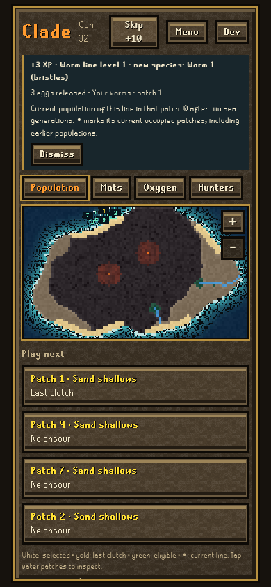
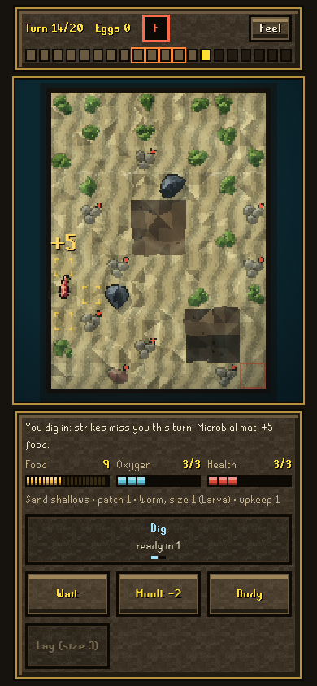
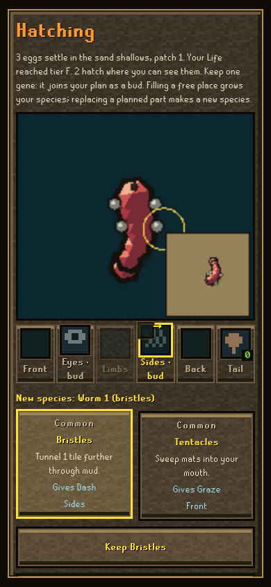
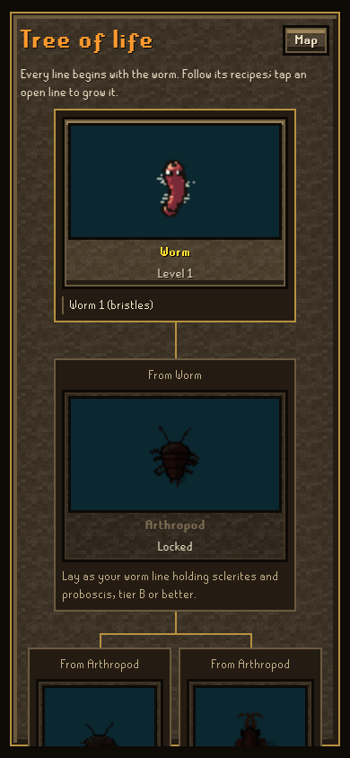

# Fable brief, part 2: the game now

Read this only after Part A of `docs/design/whole-game.md` is written (see [part 1](fable-brief.md)). It holds what
was tried, the game as built, where the user stands, the calls made and open, the current ladder against the real
tree, and Opus's reading last.

## 5. What was tried, and what playing said
| When | What | The user's verdict | Lesson |
|---|---|---|---|
| 25 Oct – 2 Nov | v1: a 96×56 tile sim (10 m tiles, grams, water, shade, nitrogen); plants hold tiles by fit, form habitats, variants mutate inside species; animals roam as individuals; genes as sliders; a tech tree | Variants "very cool"; overall "lost and random", "everything still feels really unclear"; performance worries | Sim as product, no cause and effect |
| 2–3 Nov | Plant grow toy (side view, roots, budding) | "Fun in principle", steering roots fun; "still not a good feeling game" | Directing growth works; autogrowth doesn't |
| 3 Nov | Plant M1, builds (attributes, pressures, genome upkeep) | Liked attributes, pressures, upkeep; "still seems like a toy somehow"; "I just auto every time" | Choices must bite |
| 4 Nov | Toys: A grow by turns, C body builder | "Really fun"; A "a little bit like a drafting game"; C's threats "felt really cool", placing parts "clunky" | Clear limits + visible threats |
| 4 Nov | **The Life toy** (a creature on a board: move, eat, moult, lay, a hunter) | "I started new rounds without deciding." "A great little minigame to solve." Rare mutations: "felt really compelled to go on" | **The proven core** |
| 5 Nov | Living garden toy (populations behind the Life) | Liked roaming creatures, bars, skipping; "didn't have a big pull to wait"; "really felt sad i couldn't play to fill the other niches"; "really wanted to play as a predator" | Open niches pull; waiting doesn't |
| 5 Nov | M1 run (boards, roles, verbs, tiers) | "The basics seem fun and as imagined"; "the map ust looks dead", "no real progression", "verbs should come from the body" | World and body needed |
| 5 Nov | Sea toy (patches, real populations) | "Really cool and is similar to what i've imagined"; species as numbers "confusing" | The sea model works |
| 6–7 Nov | Body toy, board looks | "The core would work"; style still open; 16 px "most my look" | One general body |
| 7–9 Nov | Join the sea; join the bodies (six places) | "The playthrough is fun", habitats "clearly noticeable"; map "clunky", the next patch "not really easy to find" | Map readability |
| 9 Nov | The climb (XP, hatching, tree, close-up) | "Really cool approaches"; but see §7 | Pull dropped |
| 9 Nov | The larva (inherited parts regrow as buds) | "A cool concept... but it might be too much" | Complexity creep |

## 6. The game as built (10 Nov)
About 7,200 lines in `game/src` (sim / data / view / ui split), 23 test files. Four lineages, three habitats.

**The loop, step by step.**
1. **The map (home).** A ring of numbered shallow-sea patches (sand, mud, rock) around a volcanic island, with
   overlays (population, mats, oxygen, hunters) and news. The sea starts empty; your first worm Life founds it.
   "Play next" lists your last clutch's patch and its direct neighbours: only those can launch a Life.
2. **The launcher.** Pick a lineage, one of its saved species (a plan), and edit the plan: six places (front, eyes,
   limbs, sides, back, tail), one part each, from the line's unlocked pool. Presets: sweeper, digger, tank, hunter.
3. **The Life** (about 5 min). An 8×11 board, 20 turns, made from the patch's stocks and residents. Move (each body
   moves differently: worm tunnels mud, arthropod runs lines, trilobite ploughs and rolls up, swimmer swims any way),
   eat food nodes (mats, buried food, shell beds, carcasses, sulfur mats), use verbs from parts (graze, dash, dig,
   sense, brace, crush; at most 3 active), dodge the hunter's marked strikes, pay upkeep each turn. **Moult** (costs
   food) to grow a size and add a part offered from the line's pool, sometimes a rare one. You hatch as a larva: plan
   parts are faded "buds" that regrow at half a moult's price. **Lay** from size 3; eggs are the score.
4. **Tier.** Eggs in this one Life set the tier: S 40, A 28, B 18, C 10, D 4. The tier also sets the released
   population's fit in the sea.
5. **Placement.** Eggs settle in the clutch's patch or a neighbour ("new ground: 50% strength").
6. **Hatching.** Eggs open as gene cards (common or rare parts). Keep one: it joins the plan as a bud. Filling a free
   place "grows" the species; replacing a planned part saves a new species ("Worm 3 (sulfur symbionts)"). Up to 6
   species are kept per line.
7. **The line.** XP = eggs × tier weight. Levels add parts to the line's pool and give a point; points buy ranks on a
   part (Lean: −1 upkeep; Enhanced: +effect; Signature: a built-in). Level 10 is the named end point (Ottoia,
   Sidneyia, Olenoides, Anomalocaris).
8. **Recipes.** Lay a line holding the right parts at tier B or better and a new lineage opens: worm + sclerites +
   proboscis → arthropod (a stand-in for the lobopod); arthropod + shield + digger → trilobite; arthropod + compound eye
   + flaps → swimmer (Anomalocaris). Shown on a tree-of-life screen as locked silhouettes with the recipe text.
9. **Watch it spread.** A replay on the map: the eggs settle, the sea runs two generations, the news says what
   happened. Then "Play next" again.

**The sea model.** Per patch: stocks of mats, rot and oxygen, and a population per species. Four rules: grazers eat
mats; burrowers eat rot and stir oxygen; hunters take prey, the commonest most; deaths become rot and rot uses oxygen.
No carrying capacity, so populations overshoot and crash; hungry ones cross borders; shocks (storm, mudslide, vent
surge) hit one patch. A generation every 3 real minutes, 8 h offline in about 5 s. **Its species are only yours:** 12
slots (4 bodies × 3 roles: grazer, burrower, hunter; role read from diet). Fit is set by releases and never changes
afterwards; nothing inside a population drifts; a line wears one body everywhere.

**Content.** 27 parts (8 rare), 6 verbs, 3 play styles plus the hunter, 5 food kinds, 4 terrains, 3 habitat boards.

**Specced next (slice 23, roadmap step 7, not built):** three algae stocks (microbial mats, plankton bloom, crust and
seaweed); who eats whom by one rule (a hunting tool, a meat-leaning gut, smaller prey); genes as body settings the sea
selects (Size and Gut first; variants budding from big populations, up to 3 per line, named after ~10 generations);
wild branches of opened lineages; sea features from sim events (vents, algal meadows, carcass falls, sponge gardens,
reefs, brachiopod beds) with a small chance when the population they need is present; lineages 4 → 10 (bristle worm,
Wiwaxia, hyolith, lobopod, Opabinia, Marrella). Words: variant (genes differ) < species (parts differ) < clade; a guild
is what an animal does; a lineage is your line.

**Screens** (390 px wide, a fresh save, seed 7; the Life was played by a greedy test bot; the map is after a forced
weak lay of 3 eggs, so the sea is still empty there):

 
 

## 7. Where the user stands now (9–10 Nov playtests, verbatim)
- **Pull dropped:** "I haven't been pulled to play more since a while, maybe I just replayed too much, I think in life
  v2 it was the most fun for me, and also finding places for different species was pretty fun. I'm not sure what
  changed to make it more repetitive, but it might just be the fresh start over and over."
- **Authorship:** "I also feel a little like we're moving in a heavy authorship direction, instead of the more free
  appearing gene combinations like in v1, where life is more fluid, but that could be ok as well."
- **The map:** "the map being linear seems a little boring"; "needs to be larger and zoomable"; "looks very clunky
  still and rough". "Maybe some coral reefs or a little more structure on the map instead of just going sideways."
- **What's yours:** "right now it feels a little confusing whats mine and whats the benefit is." "Whats exactly a
  species when is still unclear, or why."
- **Tier:** "the tier depends now just on the amount of eggs. if an s tier spreads to another patch does the s grade
  stay? the grade should be mostly refer to how good it currently fits the meta and that patch not just the number of
  eggs you got in one run."
- **Identity:** "later on the pick a build/play identity needs to be stronger." "Having only unlocked parts in your
  lineage makes it hard to change as an organism." "A lot of effects I never use." Upkeep "seems really high".
- **Recipes:** the arthropod's sclerite + proboscis "didn't make sense... lateron should use actual traits"; "maybe
  the trait for the recipe could be a rare unlock you get at some runs, or need to combine it with other oarts and a
  good score", "referring to autapomorphies for some species and clades".
- **The growth model:** "I might want to rethink growing new body parts every moult... maybe make the body then just
  grow, or spend ressources to further enfore things on a run?" Buds: "might be too much".
- **The summary:** "everything fels okay now, current gaps, species and lineage system, map, lifeforms, stats vs parts."
- Liked: hatching, the XP screen and the line close-up ("really cool approaches"); grazing "very nice"; the body
  viewer "looks cool"; "lines level really fast but that's also okay"; "i really like the ressource management one".

## 8. Calls already made, and what's open
**The milestone (M2):** the release (part 1, §3). The roadmap's done-when, an AI proposal the user may change: "I played
this run, I advanced my lineage, I can see it on the map, and I know what run I pick next"; 6–10 lineages look and play
differently; a line reaches the shore. Steps 1–6 built (quick wins, sea toy, body toy, join the sea, join the bodies,
the climb + larva); **7 the food web** (specced); 8 the shore ("to be continued" Life on the tide line); 9 the UI and
art pass for every screen and creature; 10 release (saving mid-Life, balance, clean repo, itch, Discord).

**Decided** (dates in the repo's log; argue against any of them if the vision needs it, and say so plainly):
- The Life is the core and the first zoom stage (4 Nov). Habitats are areas in the sea; the sim is not the game, but
  the living feeling is essential (4 Nov).
- A run is one Life; after it: hatching, the family tree, watch it spread (6 Nov). Systems arrive one at a time.
- Verbs come from the body; the role (grazer, burrower, hunter) comes from body and diet, not a menu (5 Nov).
- Every animal is a playable lineage; one general body with six places; code-drawn creatures (6–8 Nov).
- Recipes are made of body parts and are authored for now (6 Nov). One tree screen plus a lineage close-up (6 Nov).
- An empty sea at the start: your first Life founds it (7 Nov). Saves are no priority before release.
- Parts are tools (verbs, upkeep, picked in a Life); genes are body settings the sea selects (9 Nov). Who eats whom
  from rules, not authored layers. Sea features from sim events. Populations drift toward what the patch demands.
- The Cambrian stays for the release; the game keeps its words: line, species, part, rank, XP (9 Nov). A species keeps
  its grown body as a plan, and a Life starts as a larva with those parts as buds (9 Nov).
- Apex slot per era, one era-wide rule, your species can take it (4 Nov; later, not M2).

**Open:**
- What's yours and what it gives you: lineage runs, parallel lines, character slots. **The main question.**
- What a species is, and how variant, species, lineage and clade read to a player.
- What the tier measures.
- Whether building slice 23 waits for this pass.
- An empty or a full sea at the start ("I'm still not sure"). A less linear map.
- Growing parts every moult vs a body that "just grows". Respec.

## 9. The current ladder against the real tree (researcher, 10 Nov)
| Game node | Real group | Problem |
|---|---|---|
| Worm (Ottoia) | Priapulid, **Ecdysozoa** (with arthropods) | Fine as a start; but the start of only one of three branches |
| Bristle worm (Burgessochaeta) | Stem annelid, **Spiralia** | "Worm → bristle worm" crosses the Ecdysozoa / Spiralia split |
| Wiwaxia | Spiralia; mollusc vs annelid **debated** | Not descended from a priapulid |
| Hyolith | Spiralia; lophophorate vs mollusc **debated** | — |
| Lobopod (Hallucigenia, Aysheaia) | Panarthropod grade; gilled lobopods are stem arthropods | Mostly right as "near the arthropod root"; Hallucigenia is a side twig |
| Opabinia, Anomalocaris | Opabiniids and radiodonts: **sister** stem-arthropod lines | "Opabinia → Anomalocaris" chains two sisters |
| Arthropod (Sidneyia), trilobite | Artiopods, relatives | Sidneyia isn't the trilobites' ancestor |
| Marrella | Marrellomorph, unplaced | Fine as a side branch |
| Pikaia | Stem chordate, **Deuterostomia** | A third branch from the worm-like root |
| Shore crawler (euthycarcinoid) | Arthropod, sister to myriapods | Protichnites tracks fit; Climactichnites (probably a mollusc) doesn't |

The researcher's ideas (ideas only): one unnamed worm-like root whose first pick (cuticle, bristles and parapodia,
notochord) chooses the branch; new forms by function with a "convergent" badge; debated nodes as "discovered, rank
uncertain" that firm up with clues.

## 10. What things cost (*AI*)
A new lineage costs body data, a code-drawn look, a move rule, its part homes, and its behaviour as prey or rival in
the sea; rules, not art, limit the count. Six places and one gait set exist; anchored, jetting or rooted bodies need
their own Life rules. Each new system has cost 1–3 sessions plus reviews. The sea step costs well under a millisecond
today, so the sim has room.

## 11. Opus's reading (*AI*)
One input among the facts above, placed last so your own diagnosis comes first. Disagree freely. The user says most
points match their taste.
1. **The proven fun is the Life; the vision lives in the ecosystem.** The one link is eggs → population. The tier
   measures one Life's egg count, so the sea can't say "this build fits this patch's meta". The user caught this.
2. **Four identity layers, none is the character.** Lineage (worm), line XP, saved species (a plan), sea species (body
   × role), plus planned variants. The user's "character" is a lineage that levels all game and spawns parallel lines
   with a function each (IdleOn classes); today a lineage levels, but what lives in the sea is a body-role slot.
3. **Authored ladder vs emergence.** New forms come from checklists of parts; the loved v1 feeling was variants arising
   and winning by themselves. Slice 23's genes and variants are the first emergent layer, but they arrive after the
   ladder.
4. **Restart fatigue.** Each Life starts as a larva on a 20-turn board; buds lowered the cost of rebuilding but not the
   feeling of starting over. The Life toy that pulled hardest had no meta to repeat.
5. **Little to discover.** The tree shows silhouettes with recipe text; the sea has no hidden things yet; the map is a
   ring. Discovery is promised (features, wild branches) but not built.
6. **Placing has thin choices.** You can only place into the clutch patch or a neighbour, and the sea holds only your
   own species, so there is no one to displace, no slot to fill and no interaction between species beyond eating.
7. **Breadth vs the board.** "All branches of the tree" means plants, algae, fungi and microbes, whose ways of life
   aren't "walk and eat". How they become playable is open.
8. **The idle layer has no job for the player** beyond watching ("didn't have a big pull to wait").
9. **Process:** many reviews and specs per built system; complexity is creeping (larva buds "might be too much").

## 12. Files, if a claim needs checking
`docs/tastes.md` (all the user's tastes and lessons) · `docs/decisions.md` (dated calls) ·
`docs/design/full-version.md` (the release design) · `docs/slices/23-the-food-web.md` (step 7) ·
`docs/research/tree-for-the-game.md` (the biology) · `docs/design/tierzoo-concepts.md` (the TierZoo frame) ·
`docs/playtests/` (all notes) · `ROADMAP.md`. Off limits: `_old/`, `_archive/`, `_v1/`.
