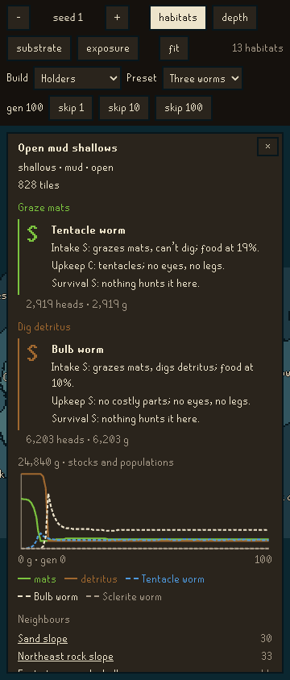

# N1 screen sheet · 10 Nov 2026, recaptured 11 Nov after the review fixes

Seed 1 at 360 × 844 and 1440 × 1000. Each build has its map preview and tapped cards; the last two rows start
from **Three worms** and skip 100. The habitat card is **Open mud shallows**, with both slots held.

| View | 360 px | Desktop |
| --- | --- | --- |
| Tentacle worm · map | [Preview](phone-tentacle-preview.png) | [Preview](desktop-tentacle-preview.png) |
| Tentacle worm · cards | [Cards](phone-tentacle-card.png) | [Cards](desktop-tentacle-card.png) |
| Bulb worm · map | [Preview](phone-bulb-preview.png) | [Preview](desktop-bulb-preview.png) |
| Bulb worm · cards | [Cards](phone-bulb-card.png) | [Cards](desktop-bulb-card.png) |
| Sclerite worm · map | [Preview](phone-sclerite-preview.png) | [Preview](desktop-sclerite-preview.png) |
| Sclerite worm · cards | [Cards](phone-sclerite-card.png) | [Cards](desktop-sclerite-card.png) |
| Three worms · generation 100 | [Map](phone-three-worms-100.png) | [Map](desktop-three-worms-100.png) |
| Slots and biomass history | [Habitat](phone-habitat-graph.png) | [Habitat](desktop-habitat-graph.png) |

Reproduce with `W=360 H=844 npm run look -- /clade/ scripts/look/n1-sheet.json` and
`W=1440 H=1000 npm run look -- /clade/ scripts/look/n1-sheet.json`. Shots land in `.shots/n1-*.png`.
The script also checks midgame and runs Three worms on seed 2. No browser errors in either capture.

Observed after the 11 Nov fixes (letters rank the build at full food, grams ×10, spread where a newcomer would grow):
three worms hold about 100 kg per sea, 0.5–20 kg per habitat. Holder letters after 200 generations on seed 2: S 2,
A 3, B 6, C 5, D 3. In Open mud shallows the tentacle worm (S) holds 2,919 g with mats at 19%. Rivals (tentacle worm
B against bare worm C) spreads to 6–8 habitats; the bare worm is gone by about generation 60.
(10 Nov, before the fixes: every settled holder read C or D, and Rivals tied 50/50 in one habitat.)

Preset choices to review: founders use 20 heads; groups start apart in their strongest available shared fit
(First worm requests shallows; Rivals (tentacle and bare worm since 11 Nov) requests sand shallows, with the best remaining ground as fallback).
Midgame starts five groups, grants the worm line one lean Tentacles rank, and advances 100 generations.
The existing worm mud multiplier, Gut gland bonus and two-head spread cutoff are unchanged.

Final verification: `npm run check` passed in **8.6 s**, all **41 tests**, including the unchanged ground and sea
timing limits. Earlier attempts exceeded timing limits while other R/database jobs occupied the host; the final
run passed after CPU load dropped. The check uses one reused test worker to reduce contention and startup cost.
